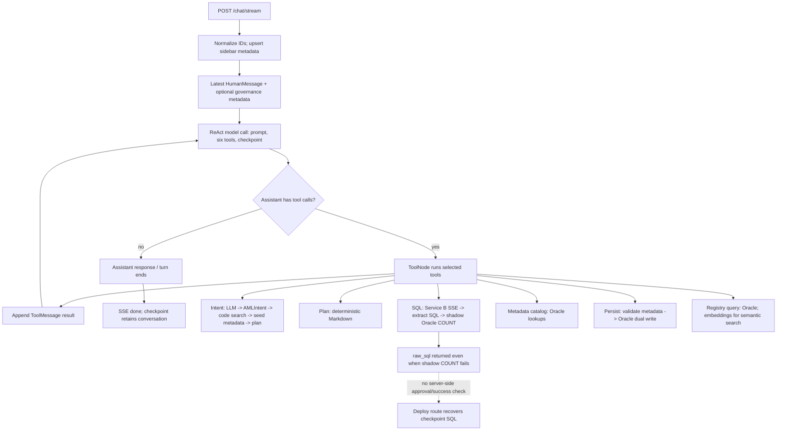

# AML Scenario Builder (Service A): Architectural Audit

**Audit date:** 2026-10-17  
**Scope:** Read-only inspection of `services/aml_builder/` and directly connected contracts/configuration. No live LLM, Oracle, or Service B calls were made. Line references are repository-relative and refer to audited source.

## 1. Executive Architecture Summary

Service A is a FastAPI application with one process-level LangGraph ReAct agent. `web/services/graph.py` creates it via `langgraph.prebuilt.create_react_agent`, binds six `@tool` functions, loads a system prompt, and attaches an asynchronous SQLite checkpointer. There is no hand-authored `StateGraph`, Python workflow router, subgraph, or server-side approval state machine in active source. The model chooses tools and their order from prompt/tool schemas; chat config sets `recursion_limit=10`.

The authoring path combines LLM intent extraction; Oracle-backed explanation-code retrieval and LLM reranking; deterministic metadata seeding and plan rendering; synchronous HTTP/SSE delegation to Service B for SQL; synchronous shadow Oracle execution; live metadata lookups and validation; Oracle persistence; and registry analytics. A direct deployment route retrieves tool outputs from graph checkpoints and writes scenario data. Other routes manage history/sidebar metadata and run the separate on-demand alert engine.

The critical correctness boundary is weakly enforced: prompts ask the model to observe approval phases, but neither tool execution nor direct deployment proves plan approval or successful shadow validation. Deployment only requires finding `raw_sql` in checkpoint output. Other major constraints are blocking integrations in async request paths, implicit graph state/context growth, and sparse automated source tests.

## 2. Repository and Module Map

| Area | Important files | Responsibility |
|---|---|---|
| FastAPI/bootstrap | `services/aml_builder/web/api/main.py` | Startup/shutdown, router inclusion, health endpoint, pool/checkpointer lifecycle. |
| HTTP routes | `web/api/routes/chat.py`, `sessions.py`, `deploy.py`, `engine.py` | Chat SSE, checkpoint history/sidebar CRUD, direct deployment, alert-engine trigger/read. |
| Agent setup | `web/services/graph.py` | Process singleton ReAct graph and AsyncSqliteSaver lifecycle. |
| Agent tools | `web/services/tools.py` | Six tools: model call, normalization, retrieval dispatch, external I/O, validation and result formatting. |
| Contracts/config | `web/services/schemas.py`, `settings.py`, `llm_client.py` | AMLIntent/chat/SSE types, environment settings, model construction/JSON parsing. |
| Prompts | `web/services/prompts/tool_driven_system.md`, `intent_extraction.md`, `loader.py` | Workflow policy and AML extraction requirements. |
| Retrieval/planning | `explanation_code_search.py`, `plan_renderer.py` | Embeddings/cache/reranking and deterministic Markdown plan. |
| Governance/persistence | `scenario_metadata.py`, `production_registry.py`, `oracle.py` | Metadata catalog/validation, atomic dual-table writer, Oracle pools/helpers. |
| Registry/alerts | `scenario_registry_analytics.py`, `alert_engine.py`, root `run_alert_engine.py` | Read-only registry analytics and on-demand alert evaluation. |
| Session metadata | `session_store.py` | SQLite sidebar table, separate from graph checkpoints. |
| Tests | `tests/test_all_transaction_code_scope.py`, `tests/test_registry_analytics.py` | ALL/ANY behavior test and manually run live integration check. |

The working tree has bytecode files implying other tests/modules (e.g., deployment guard and Service B contract tests), but corresponding `.py` files are absent. Bytecode is not active implementation/test evidence. `PROJECT_OVERVIEW.md` was used for navigation; claims below were checked against source.

### HTTP/API contracts

| Method / path | Contract and behavior |
|---|---|
| `GET /health` | Static service health (`web/api/main.py:116-126`); no dependency probes. |
| `POST /chat/stream` | `ChatRequest` (`schemas.py:491-514`) -> SSE `SSEEvent` (`:517-550`): tool_call, thinking, content, plan/catalog/result, error, done. |
| `GET /chat/{project_id}/{chat_id}/{user_id}/history` | `ChatHistoryResponse`; rebuilds conversation/artifacts from checkpoint (`routes/sessions.py:45-150`). |
| `GET /chats/user/{user_id}/list?project_id=...` | `ChatListResponse` from sidebar SQLite (`sessions.py:156-165`). |
| `DELETE /chat/{project_id}/{chat_id}/{user_id}` | Soft delete sidebar row (`sessions.py:168-179`). |
| `PUT /chat/{project_id}/{chat_id}/{user_id}/rename` | `RenameChatRequest` -> `RenameChatResponse` (`sessions.py:182-199`). |
| `PUT /chat/{project_id}/{chat_id}/{user_id}/pin` | Toggles sidebar pin (`sessions.py:201-214`). |
| `POST /scenario/deploy` | `DeployRequest(session_id,user_id,project_id,metadata_json)` -> `DeployResponse` (`routes/deploy.py:28-41,43-161`). |
| `POST /engine/run-scenarios` | `RunEngineRequest(scenario_id?,evaluation_date?)` -> run summary; executes inline (`routes/engine.py:20-48`). |
| `GET /engine/active-scenarios` | Active-scenario listing (`routes/engine.py:51-69`). |
## 3. Actual LangGraph Topology

`graph.py:31-73` creates one prebuilt ReAct graph. Exact internal nodes/edges come from the installed LangGraph version, not app-authored routing. This is the behavioral topology implied by the prebuilt agent; no custom approval interrupt or workflow node exists.



ReAct repeats model/tool rounds when the assistant returns tool calls; a response without calls terminates the turn. `chat.py:70-73` applies `recursion_limit: 10`; there is no app-specific router, approval interrupt, or retry node. Exceptions in SSE produce `error` then `done` (`chat.py:162-167`).

## 4. End-to-End Execution Traces

### Normal scenario request

1. `POST /chat/stream` chooses IDs, normalizes project, derives `{project}_{chat}_{user}`, and synchronously upserts sidebar metadata (`chat.py:50-60`).
2. Only latest request message becomes a `HumanMessage`; optional `metadata_json` is appended as plain text (`chat.py:74-79`). Prior request messages are not replayed; continuity comes from checkpoint thread ID.
3. `graph.astream` streams node updates (`chat.py:98-100`) and ReAct model/tool rounds follow model choices.
4. Intended prompt path: analyze intent, plan, await plan approval, shadow test, await result approval, prepare metadata, then explicit later-turn persistence (`tool_driven_system.md:15-51`). This is prompt policy, not server-enforced state.
5. Intent tool invokes the main LLM synchronously, parses/repairs JSON, applies fallback normalization, optionally searches codes, validates `AMLIntent`, seeds metadata and renders plan (`tools.py:193-208, 222-397, 407-427`). Separate planner can render it again (`tools.py:433-518`).
6. SQL tool submits AML intent to Service B via blocking HTTP SSE, extracts SQL and executes COUNT wrapper against shadow Oracle (`tools.py:564-643`).
7. Metadata tool fetches lookup options; persistence revalidates and writes both scenario tables atomically via `production_registry.py`.

### Missing information / clarification

`AMLIntent` defines `clarifications`, `clarification_questions`, `applied_defaults`, and `ready_for_handoff` (`schemas.py:353-385`). The intent prompt's required root list omits these fields (`intent_extraction.md:4-18`). The active analysis tool does not branch on `ready_for_handoff` or gate code search, plan, SQL handoff, or persistence (`tools.py:245-397`). The system prompt has no clarification phase. The model may ask conversationally, but source does not establish deterministic missing-field detection, answer-to-field mapping, or clarification resume.

### Resumed conversation

The same thread ID appends a new human message; checkpointer persistence is configured in `graph.py:39-44, 64-69` and route uses it at `chat.py:57, 70-79`. History reconstruction reads the checkpoint and folds tool results/artifacts into chat messages (`sessions.py:45-150`). No explicit graph interrupt/resume or answer correlation exists.

### Failures

- Graph exception: SSE emits error then done (`chat.py:162-167`).
- Empty/malformed intent output: tool returns JSON error; many exceptions are caught and turned into ToolMessage data (`tools.py:207-220, 428-430`).
- Service B HTTP/no-SQL failures become JSON error (`tools.py:583-631`). Shadow query failure still returns SQL with `validation_success:false` (`tools.py:669-683`).
- Metadata lookup errors return empty choices; validation rejects unverifiable values (`scenario_metadata.py:225-260, 367-375`).
- Direct deployment scans checkpoint ToolMessages for SQL without checking shadow success (`deploy.py:81-118`).

## 5. Node/Agent/Tool Responsibility Matrix

| Component | File:Line | Responsibility | Inputs / outputs | Dependencies | Side effects |
|---|---|---|---|---|---|
| ReAct graph factory | `web/services/graph.py:31-73` | Construct singleton agent/tool registry/checkpointer. | Prompt + tools -> graph. | LangGraph, model builder, SQLite. | Checkpoint file/connection. |
| Chat stream route | `web/api/routes/chat.py:26-177` | Identity normalization, sidebar write, input shaping, graph execution and SSE mapping. | `ChatRequest` -> SSE. | Graph, session store, LangChain messages. | Sidebar/checkpoint writes. |
| Intent tool | `web/services/tools.py:162-430` | Prompted extraction; defaults/normalization; code binding; metadata seed; plan rendering. | User prompt + optional old intent/metadata -> JSON artifact. | Main chat LLM, embeddings/Oracle/reranker, Pydantic, metadata, renderer. | LLM/Oracle reads; vector cache write. |
| Plan tool | `tools.py:433-518` | Parse intent; deterministic plan/conditions. | JSON intent -> Markdown JSON. | JSON, renderer. | None. |
| SQL/shadow tool | `tools.py:521-684` | Service B SSE, SQL extraction, shadow count and synthetic detail metrics. | Intent -> SQL + metrics. | Blocking httpx, Service B, shadow Oracle. | External request and DWH read. |
| Metadata tool | `tools.py:686-734` | Build governance catalog/options/readiness. | Metadata JSON -> catalog. | Metadata module, Oracle. | Oracle reads. |
| Persistence tool | `tools.py:736-855` | Validate metadata, compute window, generate ID, dual-write. | Intent/SQL/metadata -> result. | Validator, registry writer, primary Oracle. | Production DDL/DML. |
| Registry tool | `tools.py:858-944` | Dispatch registry query and serialize result. | Mode/query -> JSON. | Analytics, Oracle, embeddings. | Oracle/embedding reads. |
| Explanation search | `explanation_code_search.py:31-304` | Cache catalog vectors, nearest candidates, LLM rerank, format table. | Transaction types -> code records/table. | Oracle, OpenAI embeddings, fast chat model. | Oracle/API reads; pickle write. |
| Direct deploy | `web/api/routes/deploy.py:43-161` | Validate metadata, inspect checkpoint, dual-write. | Session IDs + metadata -> deployment result. | Graph/checkpointer, metadata, writer, Oracle. | Production Oracle write. |
| Alert engine | `web/services/alert_engine.py:27-380` | Load active SQL, execute/group results, write alerts. | Optional scenario/date -> summary. | Oracle pools/tables. | DWH reads and alert writes. |
| History route | `web/api/routes/sessions.py:45-153` | Reconstruct turns/artifacts from messages. | IDs -> history response. | Checkpoint, schemas. | SQLite reads. |
| Oracle helpers | `web/services/oracle.py:23-334` | Global primary/shadow pools and read/write helpers. | SQL/binds -> rows/counts. | python-oracledb, settings. | Database I/O/commits. |

`tools.py` mixes orchestration, domain normalization/defaults, retrieval, HTTP/Oracle I/O, validation and formatting. Intent analysis renders a plan that a separate tool can render again. `chat.py` couples UI event mapping to LangGraph message types; deploy/history parse tool-output JSON, coupling route behavior to internal output shapes.

## 6. LLM Invocation and Prompt Inventory

| Call site | Model/config resolution | Purpose/context | Tools/output contract | Retry/fallback |
|---|---|---|---|---|
| ReAct model `graph.py:54-69` | `build_llm(fast=False)` -> configured main model. | System prompt file or hardcoded fallback, accumulated ReAct messages/checkpoint and tool results; latest user text plus optional metadata. | All six tools; text/tool-call messages, no strict final structured contract. | Client max_retries=5; graph recursion limit 10. |
| Intent `tools.py:196-208` | Main `build_llm()`. | `intent_extraction.md` + optional existing intent JSON + current user text; no chat history passed directly. | JSON intended as `AMLIntent`; safe parse/wrapper unwrap/manual normalize then Pydantic. | No explicit app retry; empty/errors returned as JSON. Client retries up to 5. |
| Code reranker `explanation_code_search.py:182-216` | `build_llm(fast=True)` -> fast model. | Inline query prompt + up to 80 candidate descriptions/scores. | JSON array with code, description, similarity, relevance, reason; no typed validation. | Client retries up to 5; any exception falls back to vector candidates. |
| Embeddings (not chat LLM) | Direct `OpenAIEmbeddings(api_key=...)`. | Catalog documents at cache build; query phrase; live registry rows/query. | Vector lists. | Not routed through LM Studio; failures handled only by surrounding tool/analytics behavior. |
| Service B SQL generation | External service; internals unavailable. | AML scenario intent envelope. | SSE final_answer/content from which SQL is extracted. | Configured HTTP timeout; no application retry loop. |

`llm_client.py:21-72` sets `max_retries=5`, timeout 120 seconds. LM Studio path uses configured base URL and temperature. OpenAI path uses API key, optional configured reasoning effort, otherwise `none` for detected model tags (`o1`, `o3`, `gpt-5`, `reasoner`, `thinking`, `luna`); configured temperature omitted for `o1-preview`/`o1-mini`. Actual runtime env values were not inspected, so deployed model/settings are unknown. `LLM_MAX_TOKENS`, `MAX_AGENT_ITERATIONS`, and `MAX_VALIDATION_RETRIES` are settings but are not applied by observed model/route execution; the route hardcodes recursion limit 10 (`settings.py:69-77,159-166`; `chat.py:70-73`). `ChatRequest.reasoning_mode` is declared but not used to choose model/config (`schemas.py:491-514`).

Prompts: `tool_driven_system.md` states workflow/approval gates and one-call registry rules; `intent_extraction.md` specifies threshold scopes, numeric conversion, demographic filter placement, baselines, semantic condition capture and transaction-type mapping. Instructions are not technical enforcement. No explicit token budget or context trimming appears at call sites. Checkpointed messages and tool payloads can grow across turns. There is no separate developer prompt evident.

## 7. State Schema and Dataflow Analysis

No repository-defined graph TypedDict/Pydantic state or reducer is passed to `create_react_agent` (`graph.py:64-69`). App passes `{"messages": [HumanMessage(...)]}` (`chat.py:74-79`); exact message reducer/checkpoint internals are inherited from the installed prebuilt graph/dependency version.

| Data | Producer | Consumers | Lifetime / semantics |
|---|---|---|---|
| `messages` (Human/AI/Tool) | Chat route and ReAct/tool nodes. | Agent, checkpoint/history, deploy route, SSE mapper. | Persistent per thread; append/merge behavior inherited from prebuilt agent. Tool JSON is a cross-component contract. |
| `thread_id` | Chat route from project/chat/user. | Checkpointer; history/deploy candidate lookups. | Checkpoint key; no explicit session version or ownership check. |
| `metadata_json` | Sidebar/request. | Appended to human text; potentially consumed by tools/model. | Untyped JSON text in latest turn. |
| `AMLIntent` | Intent model then `AMLIntent` validation. | Plan, SQL bridge, metadata seed, persistence. | JSON in ToolMessage; not a separate versioned graph-state field. |
| Explanation candidates | Oracle/vector search and reranker. | Intent output, plan, model, UI. | Tool JSON plus global in-process/pickle cache. |
| `scenario_metadata` | Seeded intent and sidebar/user values. | Catalog, validator, persistence. | JSON through tool output/turns; existing non-null fields preserved. |
| `raw_sql`, success, metrics | SQL bridge. | SSE artifact, deploy checkpoint scan, agent. | ToolMessage persists; deploy uses SQL presence, not success. |
| Sidebar row | Chat route. | Session routes. | Separate SQLite table, keyed by chat ID. |

No explicit task-scoped state, state versioning, or app-defined reducer exists. Checkpoint recovery keys off thread ID. No application history trim/summarization rule is visible. Concurrent calls to one thread may contend; not runtime-tested. Caller-controlled IDs select state, and route-level auth/ownership checks were not found.

## 8. External Integration Contracts

### Service A ↔ Service B

`execute_oracle_dwh_shadow_test` POSTs to `PIOTECH_AI_URL` with JSON shaped as:

```json
{
  "messages": [{"role":"user","content":"{\"request_type\":\"AML_SCENARIO_GENERATION\",\"intent\":{...}}"}],
  "metadata": {"user_id":"configured value","project_id":"configured value","chat_id":"aml_tool_<8 hex>"},
  "reasoning_mode":"instant"
}
```

It uses synchronous `httpx.Client(timeout=PIOTECH_AI_TIMEOUT_SECONDS)` and `client.stream("POST", ..., Accept: text/event-stream)` (`tools.py:564-594`). It processes `data:` lines, stops at `[DONE]`, retains `final_answer.text` and concatenates `content.text`; invalid JSON lines are ignored (`:595-609`). Final answer is preferred; otherwise content is passed to `extract_sql` (`:617-623`). `extract_sql` returns the last plausible SELECT/WITH (`sql_extraction.py:12-57`). It wraps SQL in `SELECT COUNT(*) FROM (<SQL>) shadow_query` and runs `run_shadow_readonly` (`:638-643`). It expects first scalar result; detail rows are estimated as 4× header count, not queried (`:644-665`). HTTP/extraction failures return JSON errors; shadow execution failure returns SQL and `validation_success:false`.

No Service B source, auth, event ordering guarantees, internals, SQL quality/safety, output columns, or cancellation behavior were inspected. No retry loop/idempotency key is visible at this boundary.

### Other integrations

- Oracle primary pool handles lookups, registry reads, DDL/writes and alert inserts. Shadow pool falls back to primary if absent (`oracle.py:280-334`). Read-only guard checks only leading SELECT/WITH token (`oracle.py:196-225, 305-334`).
- Explanation search queries catalog, embeds documents and caches vectors in process/pickle; no TTL/source invalidation (`explanation_code_search.py:31-123`). It embeds each query and reranks each type (`:126-231`); multiple types are serial (`:234-275`).
- Registry semantic search embeds current registry text/query per request, no cache (`scenario_registry_analytics.py:108-215`).
- SQLite checkpointer and `chat_sessions` are distinct persistence systems (`session_store.py:21-80`).

## 9. Concurrency and Critical-Path Analysis

**Observed serialization:** ReAct model/tool rounds are sequential. Intent model precedes intent-dependent retrieval; multiple transaction types are searched/reranked serially. Per type, embedding precedes reranking. Service B generation precedes shadow query. Metadata validation precedes writes. These are real data dependencies.

**Potential independent work:** Per-type retrieval/reranking after shared vector-index load and independent metadata lookup queries may be candidates for concurrency, subject to provider limits/thread safety. No fan-out/fan-in is authored.

**Blocking work in async paths:** `chat_stream` synchronously calls `upsert_chat_session`; graph invokes synchronous model/tool paths; tools use `llm.invoke`, `httpx.Client`, Oracle and embeddings. Async engine routes call synchronous engine functions directly. This can occupy request/event-loop workers and limits cancellation responsiveness. Oracle pools have max/min and wait mode with 30-second acquisition timeout (`oracle.py:44-53, 84-93`); app-level concurrency limits/queues are not visible.

**Repeated/expensive work:** Main model orchestrates, intent invokes another main-model call, explanation search embeds and reranks per type, registry semantic search embeds live rows per request, and plan renders inside intent plus optional standalone planner. No latency/token/cost instrumentation is visible. LangSmith settings exist, but explicit tracing setup was not verified. No measurements were taken. Candidate optimization classes: deterministic logic, cacheable catalog vectors, async/worker-bound I/O, safe per-type parallelism, and preserving sequential validation-before-write.

## 10. Reliability, Error Handling, and Observability

- **Trust/input:** Pydantic validates shapes and AMLIntent, but caller supplies identity fields; route-level auth/authorization was not found. Sidebar metadata is appended as ordinary user content. Prompt instructions are not prompt-injection isolation.
- **Contracts:** Intent is parsed/repaired and many missing values default before Pydantic validation. Reranker output is JSON-parsed but not schema-validated. Tool outputs are JSON strings interpreted by chat/history/deploy routes.
- **Approval and SQL gate:** Prompt asks explicit approval; tools do not check approval state. Shadow failure retains SQL; direct deploy scans for any SQL and ignores `validation_success` (`tools.py:669-683`, `deploy.py:81-118`). It also does not establish SQL freshness or that SQL corresponds to submitted metadata.
- **Persistence:** `production_registry.py` writes two tables atomically, but tool and route create fresh random IDs on each deploy. No idempotency key/dedupe token ties retried actions to one logical scenario.
- **SSE:** Generator maps selected messages, suppresses other ToolMessages, catches stream errors, then sends `done`. Declared `final_answer`/`escalation_report` are not explicitly emitted by current route (`chat.py:91-167`). No explicit client disconnect cancellation code is present.
- **Failure masking:** Tool errors often become ordinary ToolMessage JSON; explanation lookup may return empty results; metadata options return empty on query failure; analytics may return partial/empty output. These can resemble valid absence of data without careful synthesis.
- **Observability:** Logging includes thread/user in some route events. No explicit trace/correlation propagation through Service B/Oracle and no stage latency/token/cost metrics were found. LangSmith settings are configured but actual tracing behavior is unverified.
- **Testing:** Source tree contains two test files; no broad offline graph/approval/SSE/deploy/persistence suite or fixtures/mocks are evident. Neither test was run in this read-only audit.

Potential failures: silent AML defaults changing population/aggregation; missing clarifications not stopping SQL generation; last-query SQL extraction selecting unintended statement; failed-shadow SQL deployed; LLM treating tool error as success; stale checkpoint artifact selection; lookup outage confusing options; and concurrent same-thread/repeated deployment producing duplicates.

## 11. Testing and Extensibility Assessment

The source test inventory is `test_all_transaction_code_scope.py` and `test_registry_analytics.py`; the latter is described as live integration with external Oracle/OpenAI. Bytecode collection artifacts do not prove active tests. No test execution is claimed.

1. **New specialized agent/reasoning task:** moderate/high; tools register centrally in `graph.py` and share one model/prompt/context.
2. **Deterministic validation:** possible within tools, but no staged router or typed transition contract exists.
3. **Tool/retriever replacement:** high coupling via `tools.py` and plain JSON assumptions consumed by routes.
4. **Replace one task model:** direct `build_llm` use works, but only a `fast` boolean policy exists; no task-level model registry.
5. **Prompt change:** prompt files are separate, but intent and orchestration prompts overlap; no prompt contract tests/versioning observed.
6. **Parallel independent work:** no graph fan-out/fan-in or concurrency-safe batch contract.
7. **New AML scenario types:** schema accepts string; no central capability registry or type-specific validation path.
8. **Clarification/UI:** fields exist, but no answer mapping/interrupt state or clarification SSE contract.
9. **Stage-level testing:** decorated tools depend on globals and synchronous external integrations; test seams/mocks are not established.
10. **Observability:** tracing settings exist, but stage metrics and correlation contracts are absent.

## 12. Architectural Findings

| ID | Severity | Component | Finding | Impact | Evidence | Candidate direction |
|---|---|---|---|---|---|---|
| F1 | Critical | Approval/deployment | Approval and shadow success are prompt-only; direct deploy accepts SQL found in a ToolMessage and ignores status. | Unreviewed or failed-shadow SQL can reach production. | `tool_driven_system.md:23-51`; `tools.py:669-683`; `deploy.py:81-118`. | Enforce server-validated deployment receipt tied to successful shadow result and scenario/thread/SQL. |
| F2 | High | Workflow/state | No explicit graph state machine for clarification, approval, completion, or stale artifacts. | LLM can skip/repeat stages; multi-turn correctness relies on prompt compliance. | `graph.py:45-69`; `schemas.py:353-385`; `tools.py:397-427`. | Add deterministic completeness/transition gates before considering additional agents. |
| F3 | High | Async execution | Blocking LLM, HTTP and Oracle operations run within async paths. | Request workers/event loop are occupied; throughput/cancellation may suffer. | `tools.py:208, 584-595, 643`; `oracle.py:220-225`; `engine.py:29-48`. | Async clients or bounded worker pools, guided by instrumentation. |
| F4 | High | Intent extraction | Unmarked defaults are introduced and clarification readiness is not enforced. | Assumptions can alter alerts without user confirmation. | `tools.py:245-293, 397`; `schemas.py:353-385`; `intent_extraction.md:4-18`. | Preserve provenance and add deterministic ambiguity gates. |
| F5 | High | Persistence contract | Deploy scans untyped checkpoint messages for SQL/intent and can select stale/mismatched artifacts. | Wrong SQL may be paired with current metadata or wrong session state. | `deploy.py:69-105, 120-143`; `sessions.py:121-142`. | Versioned typed artifacts with explicit provenance/identity. |
| F6 | Medium | Tool boundaries | `tools.py` mixes orchestration, business rules, retrieval, external I/O and persistence; routes understand tool JSON internals. | Testing/replacement difficult; changes cascade. | `tools.py:1-55, 162-430`; `chat.py:121-160`; `sessions.py:121-142`. | Split domain functions, I/O adapters and graph/UI adapters. |
| F7 | Medium | Retrieval/planning | Intent renders plan and separate planner can re-render; multi-type code reranking is serial. | Redundant deterministic work and avoidable critical-path time/cost. | `tools.py:411-427, 433-518`; `explanation_code_search.py:234-275`. | Select one plan owner; assess safe per-type parallel retrieval. |
| F8 | Medium | Shadow metrics | Detail count is fixed 4× estimate and ratio is synthetic. | UI can present estimates as measured validation metrics. | `tools.py:644-665`. | Label as estimate or calculate actual evidence if contract supports it. |
| F9 | Medium | Session identity | Full supplied history is ignored; checkpoint key uses user/project/chat but sidebar primary key is chat only. | Client/checkpoint divergence, collision and ownership surprises. | `chat.py:50-79`; `session_store.py:21-80`; `sessions.py:45-60`. | Define canonical identity and validate ownership/source of truth. |
| F10 | Medium | Tests/observability | Core orchestration, approval, SQL bridge, checkpoint extraction lack offline source coverage and stage metrics. | Regressions/diagnosis depend on live systems and manual reproduction. | Test source inventory; `chat.py`, `tools.py`, `deploy.py`. | Add deterministic contract tests and stage-level traces/metrics. |

## 13. Refactoring Opportunity Candidates

These are possibilities, not a committed architecture:

- **Split deterministic modules:** isolate JSON normalization/default provenance, channel/code binding, metadata domain rules, SQL response parsing, checkpoint artifact decoding and SSE mapping.
- **Extract graph node/subgraph:** explicit typed stages for approval/completeness/persistence where transition rules matter. These can be deterministic; six tools do not imply six agents.
- **Specialized LLM/agent:** only where an independent reasoning duty, tool access, context isolation, or execution policy is justified. Current evidence supports one intent call and one ReAct orchestrator; another agent only for modularity is not warranted.
- **Safe parallelism:** independent per-type retrieval/reranking and metadata lookups may qualify after provider concurrency/cache guarantees are known. SQL generation precedes shadow testing; validation precedes persistence; user approval remains a dependency.
- **Simplify redundant stages:** intent tool already renders plan; choose one authoritative plan-rendering path. Registry query is independent of authoring workflow.
- **External I/O:** async-native clients or bounded offload may reduce blocking; measure and confirm library support first.
- **Artifact provenance:** typed, versioned intent/shadow/deploy artifacts could replace raw ToolMessage JSON scanning and prevent stale cross-turn selection.

## 14. Unknowns and Questions

1. What are actual deployed model/provider, temperature, token limits, reasoning effort and model timeouts? Environment values were not inspected.
2. Which LangGraph/LangChain versions run in production, and what exact reducer, tool-call scheduling, checkpoint concurrency and recursion semantics apply?
3. Does frontend enforce approval/deployment rules or depend on hidden SSE behavior? Frontend source is outside this repo.
4. Does an API gateway authenticate/authorize users and restrict CORS/project ownership?
5. What is Service B's internal contract, auth, event ordering, SQL safety, schema grounding, and output-column guarantee? Only Service A boundary was inspected.
6. What are deployed Oracle DDL, constraints, indexes, grants and lookup values? No DB calls were made.
7. Does a production external scheduler invoke alert engine? None is present in inspected repo.
8. What are real latency, token/cost, pool contention, concurrency, cancellation and retry metrics? No runtime/load test was run.
9. Are provenance/default/clarification fields consumed by frontend or downstream service? Not established here.
10. Expected behavior for clarification, sidebar plan edits, or multiple SQL generations in a thread requires product contract confirmation.

### Evidence classification

- **Verified by source:** route wiring, tool registration, prompt/call sites, request payload, blocking clients, parsing, Oracle paths, checkpoint IDs, and source test inventory.
- **Verified by tests:** none claimed; tests inspected but not executed.
- **Inferred from dependency behavior:** prebuilt ReAct loop and generic message state/reducer; exact internals depend on installed version.
- **Unknown / requires runtime or external evidence:** deployed env/models, concurrency semantics, Service B internals, frontend behavior, live Oracle schema, production auth/scheduler controls.


